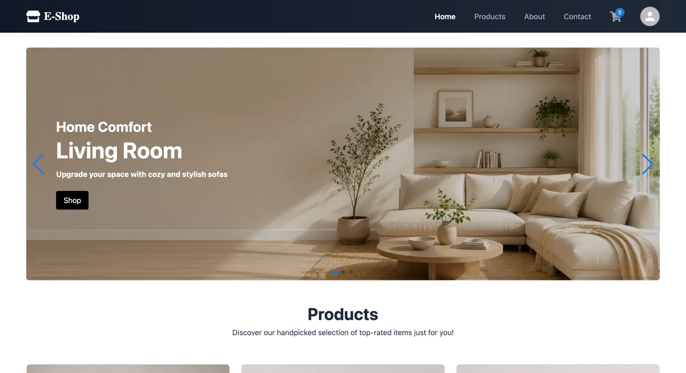
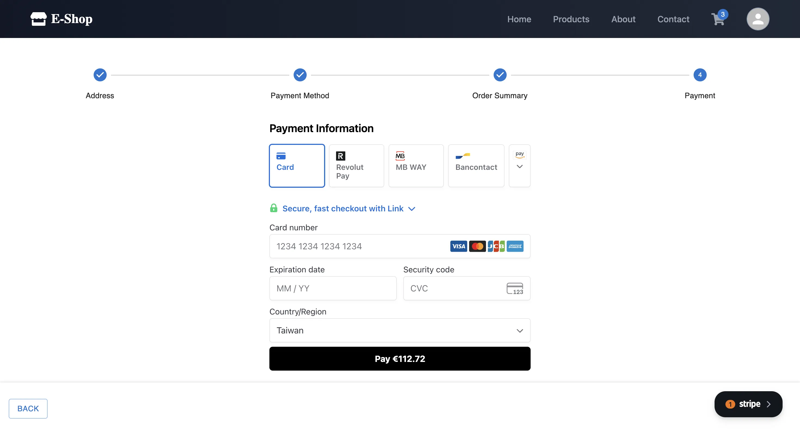

# E-Shop — React storefront

[](https://github.com/Derek376/react-ecom/actions/workflows/frontend-ci.yml)

A deployed e-commerce frontend covering the customer, seller, and administrator
journeys. It is paired with a Spring Boot API rather than mocked data.

[Live storefront](https://react-ecom-zeta.vercel.app) ·
[Backend repository](https://github.com/Derek376/sb-ecom) ·
[Swagger API](https://p01--sb-ecom--ccxd59t2vl2x.code.run/swagger-ui/index.html)

## Why I built it

Most e-commerce demos stop after adding an item to a cart. I used this project
to work through the less visible parts of the flow: where authentication should
live, which values the browser must not be trusted to calculate, how paginated
tables keep a stable order, and what the UI should show while several requests
are in flight.

The result is not intended to be a production marketplace. It is a focused
full-stack project where the checkout and role boundaries are real enough to be
reasoned about and tested.

## Product tour

### Storefront



### Product catalogue


### Order summary


### Stripe payment



### Administrator dashboard


### Seller dashboard


## What is implemented

- Responsive catalogue with search, category filters, pagination, cart, and product details
- Registration, login, profile, saved addresses, and customer order history
- Multi-step Stripe checkout with a retryable, deduplicated client-secret request
- Admin management of products, categories, sellers, orders, and analytics
- Seller-scoped product and order management
- Cloudinary image upload with client-side type and 5 MB size checks
- URL-driven dashboard sorting and pagination that survive refresh/navigation
- Separate product and category pagination state to avoid request-order races
- Deliberate loading, empty, error, and unavailable states

## Decisions that matter

**The JWT stays out of JavaScript.** Login stores only display-safe user details
in `localStorage`; authentication is carried by a secure HTTP-only cookie. Axios
sends credentials and obtains a CSRF token for state-changing requests.

**The UI does not decide what an order costs.** It displays prices, but the API
rebuilds the amount from the server-side cart and verifies the Stripe
PaymentIntent before creating an order.

**The URL owns table state.** Dashboard page and sort values live in query
parameters. A refresh or browser Back action therefore restores the same view
instead of silently changing the ordering.

**Async states are part of the feature.** Empty data is not treated as loading,
and a failed checkout request produces one recoverable error state rather than
repeated toast notifications.

## System shape

```text
React + Vite (Vercel)
        │ HTTPS, JWT cookie, CSRF header
        ▼
Spring Boot API (Northflank)
        ├── Neon PostgreSQL
        ├── Stripe
        └── Cloudinary
```

| Area              | Technology                                      |
| ----------------- | ----------------------------------------------- |
| UI                | React 19, Vite 8, Tailwind CSS 4, Material UI 9 |
| State and routing | Redux Toolkit, React Router 8                   |
| Forms and HTTP    | React Hook Form, Axios                          |
| Payments          | Stripe React / Stripe.js in test mode           |
| Tests             | Vitest, React Testing Library, jsdom            |
| Delivery          | Vercel, GitHub Actions                          |

## Run locally

Requirements: Node.js 22.22+ and the
[backend API](https://github.com/Derek376/sb-ecom) running on port `8080`.

```bash
npm install
cp .env.example .env
npm run dev
```

```env
VITE_BACK_END_URL=http://localhost:8080
VITE_FRONTEND_URL=http://localhost:5173
VITE_STRIPE_PUBLISHABLE_KEY=pk_test_...
```

`VITE_BACK_END_URL` is the origin without `/api`. Vite embeds these variables at
build time, so deployed changes require a rebuild.

## Quality checks

```bash
npm test
npm run lint
npm run build
```

The current suite has **41 tests** covering reducers, protected routes, cart
behaviour, formatting, dashboard query state, independent pagination, and
address validation. GitHub Actions runs the same test, lint, and build checks on
pushes and pull requests to `main`.

## Related

- [Spring Boot backend](https://github.com/Derek376/sb-ecom)
- [Derek376 on GitHub](https://github.com/Derek376)

MIT — see [LICENSE](LICENSE).
